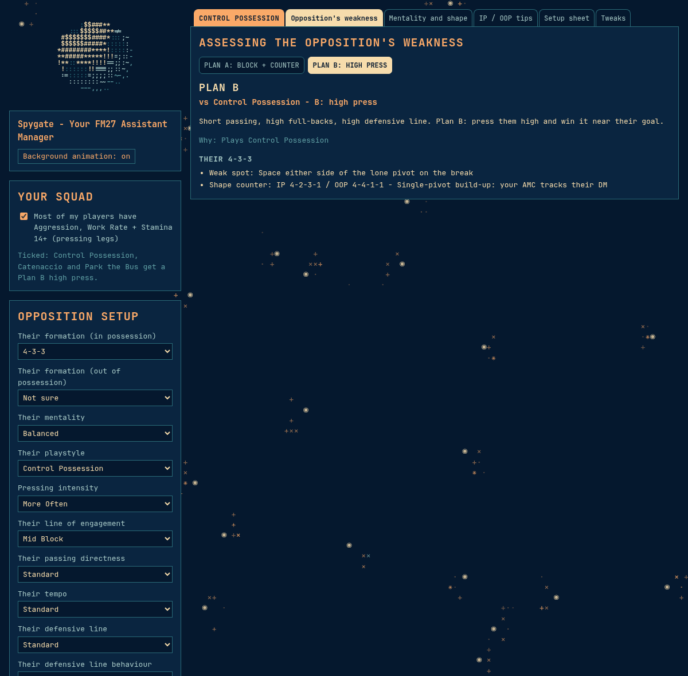
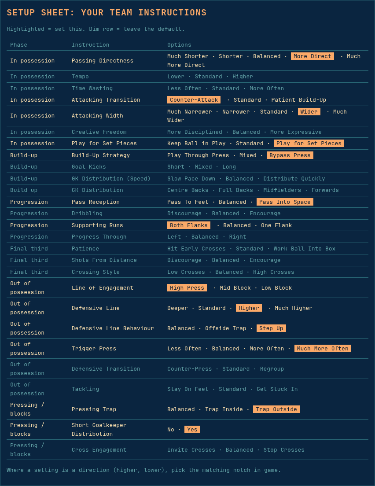
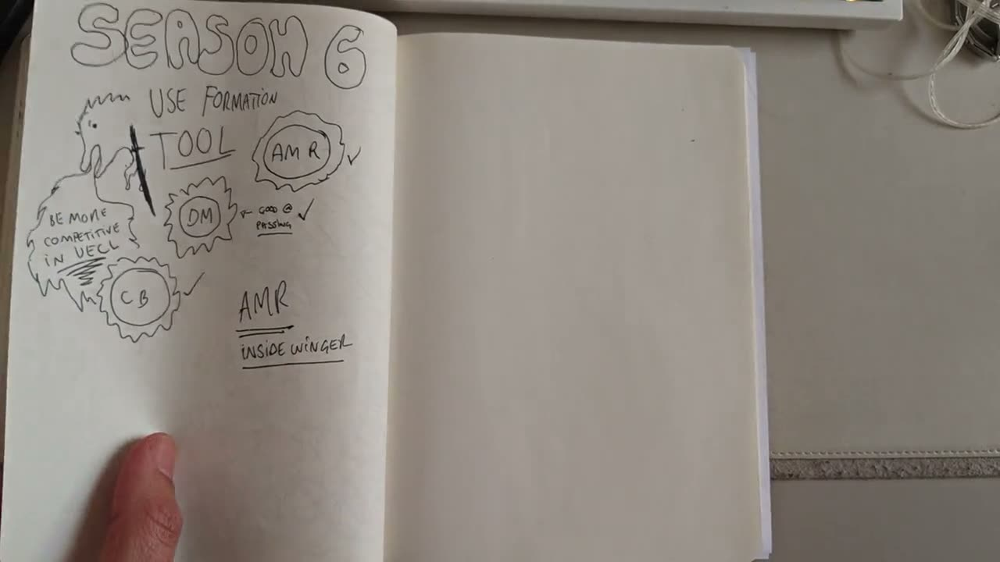

# Spygate - Your FM27 Assistant Manager

A counter-tactic helper for Football Manager 27. Describe the opponent (their in and out of possession shapes, mentality, style, pressing, defensive line, and what the scout report says) and it gives you:

- a counter plan for each of FM27's 10 playstyles (Control Possession to Park the Bus), with the reasons it was picked
- mentality, in and out of possession shapes, and in and out of possession instructions
- your formation against theirs: their weak spot, the shape that counters it, and a warning if you're outnumbered in midfield
- tweaks from the scout report (where they score and concede, set pieces, aerial strength, slow defenders, and more)
- a **setup sheet** listing just the Team Instructions to change, with the setting to pick highlighted, and any overrides explained

## Use it

**[Open it in your browser](https://fm27-spygate.pages.dev/)**, or download [`index.html`](https://raw.githubusercontent.com/okusezu/fm27-counter/main/index.html) (right-click → Save link as) and double-click it. It's one file, works offline, and needs no install.

## Screenshots

Against a Control Possession side in a 4-3-3 that presses often: the opposition's weakness tile, with Plan A / Plan B. Mentality and shape, tips, the setup sheet and tweaks are the other tabs.

The setup sheet: only the Team Instructions to change, with the setting to pick highlighted.

## Notes

⚽ *reading opposition reports is essential to get the best results out of this tool*

notetaking match engine experience for counters ⭐

## Good to know

- Built on the FM27 tactics system: separate in and out of possession roles, no duties.
- Your last inputs are remembered in your browser. The background animation can be turned off with the button at the top.

Spotted a wrong label or have a better counter? Open an issue.

## Tests

`node --test test` (Node 18+)
